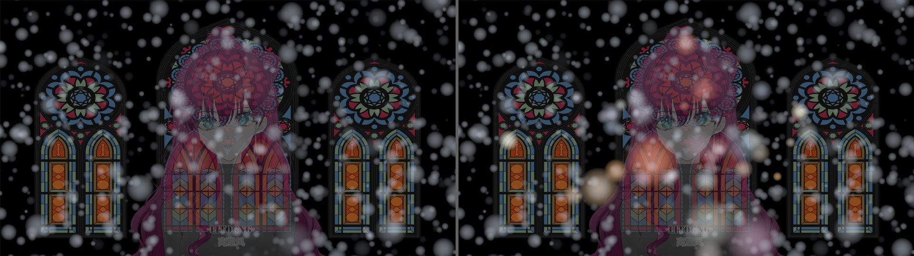

# 跨脚本 3D 光学联动：VL3D Light Field v1

> 面向 `VolumetricLight3D.obj2 v3.15+` ｜ 协议版本 `1` ｜ 接收端示例：`AviUtl2_Snow3D`

「体积光（3D）」从 v3.15 起，**每帧把当前光束的三维形状写进 AviUtl2 官方的脚本间共享表 `global`**。
同场景的其它 3D 脚本（`雪（3D）`、`体积雾（3D）`、自定义粒子系统……）读到这份「光场」后，
就能让**自己的粒子被光束照亮、染上光束的颜色**——也就是「光柱里飘的雪花会发光」的效果。

- 发布端：本仓库（`Script/VolumetricLight3D.obj2`，无需任何额外文件）
- 接收端：`AviUtl2_Snow3D`（补丁见 [`integrations/snow3d/`](../integrations/snow3d/README.zh.md)）

---

## 1. 为什么用 `global`？

官方文档 [docs.aviutl2.jp/lua](https://docs.aviutl2.jp/lua/) 里，脚本之间能共享的东西只有三类：

| 机制 | 官方说明 | 是否可用于本需求 |
| :--- | :--- | :--- |
| `global.xxx` | 「脚本之间共享的表变量，值以二进制安全字符串保存」 | ✅ **本项目采用的方案** |
| `obj.data("注册名")` | 「面向脚本模块与 DLL 的通用数据区（`--data@name:size`）」 | ❌ 是「脚本 → 自己的 DLL」通道，不是脚本间通道 |
| `obj.module("name")` | 「取得脚本模块（`.mod2`）的函数表」 | ❌ 按官方 SDK（`module2.h` / `SCRIPT_MODULE_TABLE`），`.mod2` 是**原生 DLL 模块**，不是 Lua 共享库 |
| `require()` | 官方明确提示「从脚本调用脚本可能无法正常工作」 | ❌ 不保证可靠 |

因此**不需要**额外插件、`.mod2`、共享内存或 `VL3DBridge.aux2`：只要宿主版本支持 `global`（v2.1.15 已有），
纯 Lua 就能做到，而且 `VL3DBridge.aux2` 缺席时同样工作（它的职责是 GPU 光栅化，不是数据总线）。

---

## 2. 协议（v1 基础 + v2 网格）

### 2.1 键

| 键 | 内容 |
| :--- | :--- |
| `global["VL3D_LF_IDX"]` | 纯文本索引：`VL3LF1|<scene_frame>|<layer,layer,...>` |
| `global["VL3D_LF:<layer>"]` | 该图层这一帧的光束载荷（189 字节二进制，小端） |

- 每个「体积光（3D）」实例只写自己那条槽位（`<layer>` = `obj.layer`），互不干扰。
- 索引里会**自动清理**超过 2 帧没有更新的槽位（图层被删掉 / 超出时间范围时不会残留鬼影）。
- 同一条槽位被覆盖写，永不增长；整场景 ≤ 8 条光束会被接收端读取。

### 2.2 载荷布局（v1 = 189 字节，全部小端）

| 偏移 | 类型 | 字段 |
| :--- | :--- | :--- |
| 1–5 | ASCII | `"VL3LF"` magic |
| 6 | u8 | 协议版本 = `1` |
| 7 | u8 | flags：bit0 = 使用光源图像颜色，bit1 = 有前景遮挡，bit2 = 有 3D 摄像机 |
| 8–11 | u32 | `scene_frame`（`obj.frame_s + obj.frame`） |
| 12–15 | u32 | `scene_id` |
| 16–19 | f32 | `obj.time` |
| 20–21 | u16 | 本效果好所在图层 |
| 22–23 | u16 | 光源图层 |
| 24–83 | f32 ×15 | 摄像机：位置、前/右/下单位向量、焦距、画面宽高 |
| 84 | u8 | `kind`：`0` 平行光 / `1` 从 apex 放射 / `2` 向 apex 收束 |
| 85 | u8 | 对齐填充 |
| 86–189 | f32 ×26 | 光束参数（见下） |

`f32 ×26` 的顺序：

```
W(3)       光源面中心（世界坐标，已按亮度阈值矩形居中）
axis(3)    光的传播方向（单位向量）
right(3)   光源面右向（单位向量）
down(3)    光源面下向（单位向量）
apex(3)    kind 1/2 的锥顶；kind 0 时该字段等于方向向量
r0         光源面到 apex 的轴向距离
Hx, Hy     光源面「实际发光矩形」的半宽 / 半高（世界单位）
L          光束总长（= 内部 L_tot，含衰减延长）
kdec       距离衰减系数（亮度 ≈ exp(-t·kdec)）
col(3)     光束代表色（光源图像的平均色，0..1）
lum        代表色最大通道
power      发光强度 / 100
coverage   光源填充率（阈值掩膜的平均覆盖率，0..1）
```

#### v2 追加块（v1 的 189 字节**一个都没动**，只是往后追加）

| 偏移 | 类型 | 字段 |
| :--- | :--- | :--- |
| 190 | u8 | 光源色网格边长 `G`（0 = 无，默认 12） |
| 191 | u8 | 遮挡网格宽（0 = 无，默认 32） |
| 192 | u8 | 遮挡网格高（默认 18） |
| 193 | u8 | 填充 |
| 194–197 | f32 | `occ_zmax`：遮挡网格深度的归一化上限（世界单位，默认 4096） |
| 198… | u8 × G²×3 | **光源色网格** RGB8，覆盖「实际发光矩形」，`u,v ∈ [0,1]` |
| 198+G²×3… | u8 × W×H×4 | **遮挡网格** RGBA8，见下 |

遮挡网格每个格子 4 字节：

```
R  2D 前景剪影覆盖率 ×「遮挡的强度」（0..255）
G  3D 物体（.obj / .vrm）覆盖率（0..255）
B  3D 表面在相机空间的深度 = B/255 · occ_zmax（255 = 该格没有 3D 表面）
A  2D 遮挡物平面在相机空间的深度 = A/255 · occ_zmax（255 = 该格没有 2D 遮挡）
```

`flags` 的 bit3 表示带颜色网格、bit4 表示带遮挡网格；接收端必须按这两个位与长度自行判断，
**不能假设网格一定存在**（没有遮挡时载荷只有 629 字节）。

### 2.3 接收端怎么算「受光」

对每个粒子中心 `p`（世界坐标）与每条光束：

```
v   = p - W
t   = dot(v, axis)                       轴向距离（从光源面算起）
kind 0 : ex, ey = Hx, Hy
kind 1 : s = r0 + t;  ex, ey = Hx·s/r0, Hy·s/r0      （放射 → 断面变大）
kind 2 : s = r0 - t;  ex, ey = Hx·s/r0, Hy·s/r0      （收束 → 断面变小）
q   = |(dot(v,right)/ex, dot(v,down)/ey)|           归一化椭圆半径
cov = smoothstep 边缘柔化（柔化宽度 ∝ 粒子半径）
w   = cov · exp(-max(t,0)·kdec) · endFade(t) · power
```

`w` 就是受光量：`0` = 光束外，`1` ≈ 光束中心。

**v2 的两项修正**（都发生在接收端，仍然没有任何额外着色器 / 渲染目标）：

```lua
-- ① 颜色：把粒子射影到光源面，取颜色网格的 (u,v)（双线性）
u = 0.5 + 0.5 · dot(v, right) / Hx
v = 0.5 + 0.5 · dot(v, down)  / Hy
col_p = colourGrid(u, v)            -- 彩色玻璃窗 → 每颗雪粒拿到自己的颜色

-- ② 遮挡：用粒子自己的屏幕位置与相机深度
zc = dot(p - camPos, camForward)                       -- 相机深度
su = 0.5 + dot(p - camPos, camRight) · focal / (scrW · zc)
sv = 0.5 + dot(p - camPos, camDown)  · focal / (scrH · zc)
cell = occlusionGrid(su, sv)                            -- 32×18 的粗网格
if cell.R > 0  and zc > cell.A · zmax / 255 then  w ·= 1 - R/255   -- 2D 前景之后
if cell.G > 0  and zc > cell.B · zmax / 255 then  w ·= 1 - G/255   -- 3D 物体之后
```

也就是说：**粒子在遮挡物「后面」才变暗，在它前面照常受光**（这正是体积光自身渲染时空隙的判定方式）。
颜色与遮挡都是逐粒子的，因此「红色玻璃窗前面的雪粒发红光、蓝色窗前面发蓝光、
被人物挡住的那几颗不发亮」会同时成立。

整个过程**只用 4 则运算、`sqrt`、`exp` 与几次字节读取**，粒子 1 个 1 条光束约 40 次浮点运算；
不读取 VRAM、不增加渲染目标、不加任何着色器通路。

---

## 3. 图层顺序与延迟

时间轴自上而下渲染，因此：

```
Layer 1  背景 / 光源图层
Layer 2  前景 3D / 2D 遮挡物
Layer 3  ★ 体積光（3D）      ← 先渲染 → 本帧光场已写入
Layer 4  雪（3D）            ← 后渲染 → 读到「本帧」光场，零延迟（推荐）
```

若把雪放在体积光**上方**（先渲染），它会读到**上一帧**的光场：正常播放时肉眼无法察觉，
但拖动时间轴跳转的那一帧可能有 1 帧的色差。接收端允许 ±2 帧的时间戳偏差，超出则视为无效，不会出现「幽灵光」。

雪（3D）等对象自身的标准变换（位置/旋转/缩放）不影响结果：两边都以「摄像机 3D 空间（世界坐标）」计算，
发布端写入世界坐标，接收端把粒子从自身局部坐标换算回世界坐标再采样。

---

## 4. 已知限制

1. **遮挡是粗粒度的**：遮挡网格只有 32×18（一帧一次 GPU 1 个小 pass + 一次 2.3KB 读回），
   所以「半个粒子在影子里」这类亚像素过渡不存在——按格子整体判断，边缘有约 1 格（画面宽度 1/32）的量化。
   细小的镂空（发丝缝隙、细网）会被格子合并；需要更锐利的边界时可提高发布端的网格尺寸
   （`VL_LF_OGRID_W/H` 常量，接收端会自动适配）。
2. **颜色网格是 12×12**：彩色玻璃的细花纹会被平滑（每格约占画面 1/12），
   相邻不同颜色的窗格仍能分辨，但比体积光本体（逐像素）柔和。`G` 同样记录在载荷里，可自行调大。
3. **遮挡物必须是 2D 前景层或 .obj/.vrm**：与体积光自身的遮挡设置一致（`遮蔽対象` 的
   自动检测 / 指定图层 / 3D 模型）。体积光关闭遮挡时，光场也不含遮挡（因为本来就没有算）。
4. **每条光束的网格是独立的**：多实例时每层各自发布自己的遮挡网格（同一画面内容会重复约 2.3KB/帧）。
5. **最多读取 8 条光束**（每层 1 条），超过的部分忽略。
6. 若宿主未来移除 `global`，发布端与接收端都会**自动静默关闭**，不会报错、不影响原有画面。

---

## 5. 效果预览

<div align="center">
  
  <br />
  <sub>左：关闭「被体积光照亮」 ｜ 右：开启（光束内的雪花按所在光源位置染上彩窗颜色并加算发光，被人物挡住的不发亮）</sub>
  <br />
  <sub>复现：<code>cd sandbox && python3 render_lightfield_demo.py</code>（沙箱近似投影，非真机像素）</sub>
</div>

---

## 6. 想给自己的脚本接入？

只要实现「读 `global` + 采样」两步即可，参考 `integrations/snow3d/lua/receiver.lua`（约 330 行纯 Lua）：

```lua
local SNOW_LF = (function()
    -- 1) 每帧一次：解析 VL3D_LF_IDX，再把各层 VL3D_LF:<n> 解码成光束表
    --     （v1 光束形状 + v2 颜色网格 / 遮挡网格，两者都可缺省）
    -- 2) 每个粒子一次：
    --     SNOW_LF.sample(x, y, z, particle_radius) -> r, g, b, lit
    --     r,g,b 是该粒子位置的光束颜色（无网格时退回平均色）
    --     lit 已经乘过遮蔽可視率
end)()
```

渲染侧建议：把 `lit` 够大的粒子用**加算合成**再画一遍（着色可用 `obj.load("figure", 图形, 光束色, 尺寸)`
或"像素着色器乘色 + `obj.setoption("blend","add","force")`"），就能得到「雪粒吃光」的观感。
本项目对雪（3D）的做法是后者——保留原有柔边形状，只把颜色乘以光束色。

---

## 7. 验证

```bash
cd sandbox
python3 run_checks.py --only lightfield          # 10 项：载荷格式/几何自洽/索引维护/纯 Lua 打包器/接收端数学/健壮性/补丁幂等/雪 3D 端到端
VL3DSB_SNOW3D=/path/to/AviUtl2_Snow3D python3 run_checks.py --only lightfield
```

沙箱用真实 LuaJIT 执行 `.obj2`，并用两个 Host 互相传递 `global` 快照来模拟「两个脚本同处一个宿主」。
CPU 沙箱不能替代 Windows + AviUtl2 真机像素验收。
