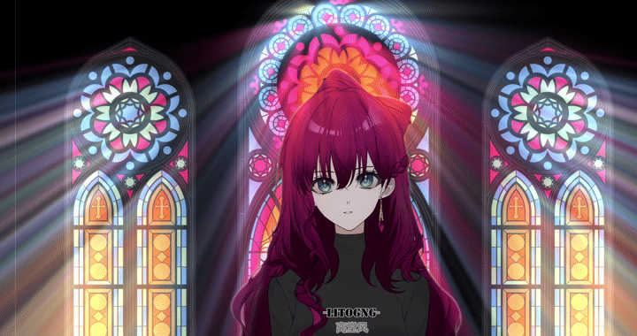
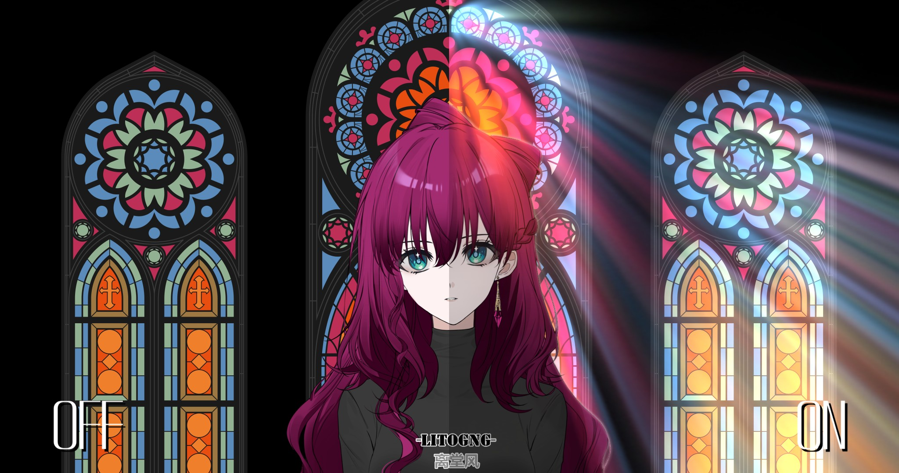

<div align="center">

# Volumenlicht (3D) / 体積光（3D） / 体积光（3D）

🎉 **ERSCHÜTTERNDER START!!!**  
**DAS ECHTE 3D-Volumenlicht (God Rays / Krepuskulare Strahlen / Lichtstrahlen) für AviUtl ExEdit2**  
**Mit eingebauter 3D-Vordergrund-Einblendung & optionalem D3D11-CS-Hardware-Schattenbeschleuniger**

`体積光（3D）.obj2 v3.06` &nbsp;|&nbsp; `VL3DBridge.aux2 v1.21` &nbsp;|&nbsp; `AviUtl ExEdit2 v2.1.15+` &nbsp;|&nbsp; `MIT License`

**🌐 Sprache:** &nbsp; **[简体中文 (Chinesisch)](../README.md)** &nbsp;|&nbsp; **[日本語 (Japanisch)](README_ja.md)** &nbsp;|&nbsp; **[English](README_en.md)** &nbsp;|&nbsp; **Deutsch**

*(4 UI-Sprachen unterstützt: 日本語 / 简体中文 / English / Deutsch)*

</div>

---

<div align="center">
  
  <br />
  <sub>▲ Echtzeit-Emission von 3D-Volumenlichtstrahlen, 2D/3D-Vordergrund-Schattensäulen und Randlicht-Einblendung</sub>
  <br />
  <sub>🎨 Hintergrundkunst der Demo-GIFs / Vergleichsbilder: <a href="https://www.magnific.com/free-vector/stained-glass-colorful-mosaic-cathedral-windows-dark-gothic-church-beautiful-interior-view-clouseup-illustration_21744714.htm#fromView=search&page=1&position=16&uuid=53b685e2-b869-4009-938e-495a85eac145&track=ais_hybrid&query=Stained+glass">Magnific — Verglaste Kathedralfenster (kostenloses Vektorbild)</a></sub>
</div>

<br />

<div align="center">
  
  <br />
  <sub>▲ Links: OFF (Roh-Ebenen) ｜ Rechts: ON (Volumenlicht (3D) + Vordergrund-Abschattung + Vordergrund-Einblendung)</sub>
  <br />
  <sub>🎤 Demo-Modell: DiffSinger-KI-Virtual-Sängerin <b>Nangong Yan (南宫颜)</b> (<a href="https://cylnanangong.wixsite.com/ngyy">Offizielle Website</a> ｜ <a href="https://github.com/CylnaNangong/NGYY_ENG_Dataset">GitHub-Englisch-Datensatz</a>) · Charakter-Illustration via <a href="https://www.neka.cc/">neka.cc</a> von Künstler <b>Litangfeng (离堂风)</b></sub>
</div>

---

## Inhaltsverzeichnis

- [1. Übersicht & Kernfunktionen](#1-übersicht--kernfunktionen)
- [2. Systemanforderungen](#2-systemanforderungen)
- [3. Installation (`.au2pkg.zip`-Drag-and-Drop unterstützt)](#3-installation-au2pkgzip-drag-and-drop-unterstützt)
- [4. Erste Schritte & empfohlene Ebenenreihenfolge](#4-erste-schritte--empfohlene-ebbenreihenfolge)
- [5. Vollständiges Parameter-Referenz (Zum Ausklappen klicken)](#5-vollständiges-parameter-referenz-zum-ausklappen-klicken)
- [6. Kompatibilitätsrisiken durch Memory-Probes](#6-kompatibilitätsrisiken-durch-memory-probes)
- [7. Zukunftsroadmap](#7-zukunftsroadmap)
- [8. Fehlerberichte](#8-fehlerberichte)
- [9. `VL3DBridge.aux2` kompilieren & `.au2pkg.zip`-Pakete erstellen](#9-vl3dbridgeaux2-kompilieren--au2pkgzip-pakete-erstellen)
- [10. Autoren, Danksagungen & Lizenz](#10-autoren-danksagungen--lizenz)

---

## 1. Übersicht & Kernfunktionen

**`Volumenlicht (3D)` (`体積光（3D）`)** ist **DAS ECHTE 3D-Volumenlicht (God Rays / Krepuskulare Strahlen / Lichtstrahlen)**-Objekt für **AviUtl ExEdit2**. Es vergrößert helle Pixel aus einer beliebigen Quellebene (Bilder, Videos, Text, Formen oder prozedurale Objekte wie `@水面`) oder direkt aus einer 3D-Lichtquelle im **Kamera-Control (`カメラ制御`)** in den 3D-Raum hinaus und erzeugt physikalische 2D/3D-Schattensäulen sowie natürliche Vordergrund-Einblendungen.

### ✨ Kernhochpunkte

1. **Echte 3D-Ray-Scheiben-Volumenintegration**
   - Unterstützt **Parallel**-, **Ausstrahlend (Punktlicht)**- und **Bündelnd**-Modi, behält dabei 100 % der Farbinformation der Quellebene pro Pixel (mit optionaler Einfärbung), mit sanfter Schwellen-Extraktion, Abnahme mit der Distanz und animiertem 3D-Nebel-/Staub-Rauschen im Strahlinneren.
   - Kamera-ausgerichtete Schaltflächen (dynamisch zwischen 64 und 192 Schallplatten skalierend) verhindern Schichtrisse bei 360°-Kameraumläufen, ohne dass `.obj`- oder `.vrm`-3D-Modelle halbtransparent „durchsehen“ werden.

2. **Hybride Vordergrund-Abschattung: 2D-Ebenen + 3D-Modelle (`.obj` / `.vrm`)**
   - Erzeugt volumetrische 3D-Schattensäulen aus vorderen 2D-Ebenen, `Text`-Objekten (alle **18 Textausrichtungen** und **7 Schatten-/Randdekorationen** vollständig unterstützt), Standard-`.obj`-3D-Modellen und `.vrm`-Avataren (`VRMToolkitModel`) mit dunkelrandfreier Konturschutz-Behandlung.
   - Unterstützt bis zu **8 Vordergrund-Abschattungen** (2D-Ebenen / `Text`-Ebenen; Schattensäulen von `.obj` / `.vrm`-3D-Modellen werden separat gerastert und sind nicht davon begrenzt).

3. **Eingebaute 3D-Vordergrund-Einblendung (AutoBlendLight-Integration)**
   - Integriert **nctype**s [`AutoBlendLight`](https://github.com/nctype/aviutl2_script_AutoBlendLight) (MIT-Lizenz) direkt in das `.obj2` als 3D-Strahl-bewusste GPU-Pipeline (standardmäßig AUS, bei Bedarf AN — kein zusätzliches `.anm2` nötig).
   - Erkennt automatisch alle vorderen 2D-Ebenen oder akzeptiert individuelle Ebenenbereiche (`4-5`, `3,5,7-9`), samplingt richtungsabhängige Farben aus dem 3D-Volumenlichtstrahl und der unscharfen Hintergrundhelligkeit, und umhüllt die Vordergrundfiguren mit realistischen Gegenlicht-Verläufen oder scharfen Rand-Highlights — während vorderste Untertitel/UI-Ebenen automatisch geschützt bleiben.

4. **Optionaler Begleit-Plugin `VL3DBridge.aux2`: D3D11 ComputeShader + Lock-Free-Bridge**
   - **GPU-Hardware-Rasterizer (`cs_5_0`)**: Nutzt die offizielle `EDIT_HANDLE::get_direct3d_device()`-API von AviUtl2 `v2.1.15+`, um 3D-Schattenkarten und Kameratiefenkarten auf der GPU zu rasterisieren — **20x–45x schneller** bei hochpolygonen Meshes, mit 100 % voller Dreiecks-Schattentreue auch beim Drag & Drop.
   - **Lock-Free-Parameter-Lesung**: Liest Szenenparameter direkt via `SCRIPT_MODULE_PARAM::edit`, beseitigt UI-Deadlocks beim Drag und verfolgt ungespeicherte (`vor Ctrl+S`) Textausrichtungen und Parameterbearbeitungen augenblicklich.
   - **3-Stufen-Auto-Fallback**: `D3D11_CS (GPU)` → `C++17 -O3 (CPU)` → `Reines LuaJIT FFI`. Alles funktioniert auch ohne `VL3DBridge.aux2`!

5. **Strenges 16-Megapixel-Cache-Budget & 8K / 16K-Resilienz**
   - Entwickelt, um streng innerhalb von AviUtl2s Standard-`TemporaryImageCacheSize` (16 Mio. Pixel) und D3D11-`4096px`-RTV-Grenzen zu bleiben — selbst bei **8K UHD (`7680×4320`)**-Canvas oder **50 MP / 16K**-Quellmaterialien (Live-Cache-Peak ~`3.9 M–7.2 M` Pixel, am Frame-Ende wieder auf `1×1` freigegeben).
   - Beim ersten Laden schwerer Szenen oder Sub-Scenes werden `Initializing...` / `Initialization complete`-Hinweise in der Konsole ausgegeben, damit Wartezeiten bei der Dekodierung großer Assets nicht als Einfrieren missverstanden werden.

---

## 2. Systemanforderungen

| Komponente | Anforderung / Hinweise |
| :--- | :--- |
| **OS** | Windows 10 / Windows 11 (64-Bit) |
| **Host-Anwendung** | **AviUtl ExEdit2 `v2.1.15` (2026-10-24) oder neuer empfohlen**<br><sub>*Hinweis: `VL3DBridge.aux2 v1.21` nutzt die in `v2.1.15` hinzugefügte offizielle D3D11-Geräte-API für die `cs_5_0`-GPU-Schattenbeschleunigung. Frühere `v2.0.54+`-Builds fallen automatisch auf den C++ `-O3`-CPU- oder reines-LuaJIT-Pfad zurück.*</sub> |
| **GPU** | DirectX 11 (`Shader Model 5.0` / `cs_5_0`)-kompatible GPU (NVIDIA / AMD / Intel Arc oder iGPU) |
| **Cache-Konfiguration** | Funktioniert out-of-the-box mit AviUtl2s Standard-`TemporaryImageCacheSize` (16 Mio. Pixel) |
| **Optionaler Begleit-Plugin** | [`VRMToolkit`](https://github.com/nove-nove/aviutl2-vrm-toolkit) (`VRMToolkitBridge`) wird nur benötigt, wenn `.vrm`-Avatare als 3D-Abschattung genutzt werden |

---

## 3. Installation (`.au2pkg.zip`-Drag-and-Drop unterstützt)

### 🚀 Methode 1: `.au2pkg.zip`-Paket per Drag & Drop auf das Vorschaufenster (empfohlen — sofort einsatzbereit!)

1. Laden Sie das aktuelle Paket von **GitHub Releases** herunter (**nicht entpacken**!):
   - **`VolumetricLight3D-v3.06.au2pkg.zip`** (Komplett-Edition: Kernskript + `VL3DBridge.aux2`-GPU-Plugin + Sprachpakete)
   - *Oder `VolumetricLight3D-v3.06-ScriptOnly.au2pkg.zip` (Nur-Skript-Edition: `.obj2` + Sprachpakete ohne natives `.aux2`)*
2. Öffnen Sie AviUtl ExEdit2 und **ziehen Sie die `.au2pkg.zip`-Datei direkt per Drag & Drop in das AviUtl2-Vorschaufenster**; bestätigen Sie den Installationsdialog.
3. Wenn die Komplett-Edition mit `VL3DBridge.aux2` installiert wurde, **starten Sie AviUtl2 einmal neu**, um das native Plugin zu laden (die Verwaltung/Entfernung des Pakets ist jederzeit im AviUtl2-Menü „Paketinformationen“ möglich).

### 📂 Methode 2: Manuelle Ordner-Kopierung

Kopieren Sie die **`Script`**-, **`Plugin`**- (empfohlen) und **`Language`**-Ordner in Ihr AviUtl2-Datenverzeichnis (typischerweise `C:\ProgramData\aviutl2\`, oder neben `aviutl2.exe` bei Portable-Installationen):

```text
C:\ProgramData\aviutl2\
├── Script\
│   └── 体積光（3D）.obj2                  # [Erforderlich] Kern-Objekt-Skript (v3.06)
├── Plugin\
│   ├── VL3DBridge.aux2                    # [Empfohlen] Lock-Free-Lesung & D3D11-CS-GPU-Schatten-Plugin (v1.21)
│   └── VL3DBridge.ini                     # [Optional] Probe-Whitelist & GPU-Konfiguration (neben .aux2)
└── Language\                              # [Optional] UI-Lokalisierungspakete (Japanisch ist eingebaut)
    ├── 简体中文.体積光（3D）.aul2
    ├── English.体積光（3D）.aul2           # <-- Übersetzt UI & Tooltips ins Englische („Volumetric Light (3D)“)
    ├── Deutsch.体積光（3D）.aul2
    └── community_de.体積光（3D）.aul2
```

### 💡 Nur `.obj2` vs. mit `VL3DBridge.aux2` kombiniert

| Arbeitsfluss / Szenario | Nur `Script\体積光（3D）.obj2` | Mit `Plugin\VL3DBridge.aux2` kombiniert (Empf.) |
| :--- | :--- | :--- |
| **2D-Bild / Video / Text-Strahlen + Vordergrund-Einblendung** | Volle GPU-HLSL-Geschwindigkeit | Gleiche GPU-Geschwindigkeit + **instantanes Tracking ungespeicherter Textausrichtung & Dekoration** |
| **Hochpolygone `.obj` / `.vrm`-Kameraflugnahmen** | Reiner LuaJIT-CPU-Rasterizer (stärker bei dichter Mesh-Dichte) | **D3D11 `cs_5_0` GPU-Parallel-Rasterizer (`20x–45x` schneller)** |
| **Live-Parameter-Drag mit aktivierter Abschattung** | Auto-Downscaling & 12-ms-CPU-Cap beim Drag | **Null-Lock-Konflikte + 100 % vollpolygonale Echtzeit-Schatten** |

---

## 4. Erste Schritte & empfohlene Ebenenreihenfolge

AviUtl ExEdit2 rendert Zeitleistenebenen **von oben nach unten (`Layer 1 → Layer N`)**. Platzieren Sie **`Volumenlicht (3D)`** **unterhalb** Ihrer Lichtquellen- und Vordergrundfiguren-Ebenen und **oberhalb** der vordersten Untertitel-/UI-Ebenen:

```text
Layer 1  [Hintergrund / Lichtquelle]  Bild, Video, Text, Form, @水面 usw. (z. B. Quellebene = 1)
Layer 2  [Vordergrund-3D-Modell]      .obj-3D-Modell oder .vrm-Avatar (wirft physikalische 3D-Schattensäulen)
Layer 3  [Vordergrund-2D-Ebene]       Figuren-Ausschnitt / Requisite (abschattet & optionale Vordergrund-Einblendung)
Layer 4  [Volumenlicht (3D)]  ★   ← Custom-Objekt „Volumenlicht (3D)“ hier hinzufügen, Quellebene = 1 setzen
Layer 5  [Untertitel / UI-Overlay]    Unterhalb von Volumenlicht platziert, bleibt Text/UI scharf und unbeeinflusst
```

> [!NOTE]
> **⏳ Hinweis zum ersten Szenenladen (~10 Sekunden Erstkompilierung — NICHT EINGEFROREN!)**  
> Beim ersten Hinzufügen von `Volumenlicht (3D)`, beim Öffnen eines Projekts mit diesem Effekt oder beim Wechsel in eine Sub-Scene innerhalb einer AviUtl2-Sitzung kompiliert der Host alle 14 eingebetteten HLSL-Shader und initialisiert hochauflösende Texturen/Meshes. Dies kann die Vorschau für **etwa 5–15 Sekunden (typischerweise ~10 Sekunden bei hochauflösenden Szenen)** anhalten. Auch wenn das Protokoll-Fenster geschlossen ist, warten Sie bitte kurz — danach läuft Playback und Scrubbing in Echtzeit!

---

## 5. Vollständiges Parameter-Referenz (Zum Ausklappen klicken)

Alle **47 Parameter in 6 UI-Gruppen** (Deutsche UI-Labels aus `Deutsch.体積光（3D）.aul2` neben den ursprünglichen japanischen Schlüsseln):

<details>
<summary><b>📐 Gruppe 1: Strahlform (<code>形</code> — 12 Parameter: Quellebene, 3D-Abstrahlgeometrie, Länge &amp; Abnahme)</b></summary>

| Parameter (DE / JA) | Bereich / Optionen | Standard | Beschreibung & Tipps |
| :--- | :--- | :---: | :--- |
| **Quellebene** (`光源レイヤー`) | `0 – 100` | `0` | Ebenennummer der Lichtquelle (Bild, Video, Text, Form, `@水面`; `0` = nicht gewählt, oder direkt 3D-Kameralicht bei aktiver Kameralicht-Nachführung). |
| **Abstrahlart** (`光の出方`) | `Parallel` / `Ausstrahlend` / `Bündelnd` | `Parallel` | Strahlgeometrie: parallele Säulen, von einem virtuellen 3D-Brennpunkt ausgestrahlt oder auf den Brennpunkt gebündelt. |
| **Strahlfüllung** (`光の中身`) | `Volumenlicht` / `Flächig` | `Volumenlicht` | `Volumenlicht` erzeugt natürliche atmosphärische Tyndall-Streuung; `Flächig` erzeugt stilisierte scharfe Lichtsäulen. |
| **Richtung** (`方向`) | `-360° – 360°` | `55.0` | *(Parallel-Modus)* Projektionswinkel in der Ebene in Grad. |
| **Vorwärtsneigung** (`手前角度`) | `-90° – 90°` | `44.0` | *(Parallel-Modus)* 3D-Neigungswinkel, der den Strahl nach vorne zum Betrachter tilt. |
| **Bildraum-Richtung** (`画面基準`) | `AN / AUS` | `AN` | *(Parallel-Modus)* Bei AN wird die Richtung im Bildraum berechnet; bei AUS relativ zu den lokalen Achsen der Quellebene. |
| **Streuwinkel** (`拡散角度`) | `-160° – 160°` | `22.0` | *(Parallel-Modus)* Kegel-Öffnungswinkel: `0°` = exakt parallel, positiv = auffächert, negativ = gebündelt. |
| **Lichtquelle X** (`光源X`) | `-100000 – 100000` | `0` | *(Ausstrahlend / Bündelnd)* X-Versatz des virtuellen 3D-Brennpunkts (Pixel). |
| **Lichtquelle Y** (`光源Y`) | `-100000 – 100000` | `-300` | *(Ausstrahlend / Bündelnd)* Y-Versatz des virtuellen 3D-Brennpunkts (Pixel). |
| **Lichtquelle Z** (`光源Z`) | `10 – 20000` | `1400` | *(Ausstrahlend / Bündelnd)* Z-Abstand zwischen Quellebene und virtuellem Brennpunkt (kleiner = breiter Fächer). |
| **Länge** (`長さ`) | `0 – 12000` | `2500` | Gesamtlänge des Lichtstrahls im 3D-Raum (Pixel). |
| **Abnahme** (`減衰`) | `0 – 100%` | `55.0` | Helligkeitsabnahme mit der Distanz (`0%` = gleichmäßig hell, höher = sanfter Verlauf am Strahlenende). |

</details>

<details>
<summary><b>💡 Gruppe 2: Licht &amp; Farbe (<code>光</code> — 4 Parameter: Farbe, Intensität, Schwellenwert &amp; Kamera-3D-Lichtkopplung)</b></summary>

| Parameter (DE / JA) | Bereich / Optionen | Standard | Beschreibung & Tipps |
| :--- | :--- | :---: | :--- |
| **Lichtfarbe (Opt)** (`光の色`) | Farbauswahl / Leer | *Leer* | **Leer lassen, um 100 % der Farbinformation der Quellebene pro Pixel zu erhalten**; eine Farbe wählt das gesamte Licht einheitlich. |
| **Intensität** (`強さ`) | `0 – 1000%` | `100.0` | Gesamthelligkeits-Multiplikator der Strahlung. |
| **Schwellenwert** (`しきい値`) | `0 – 100%` | `15.0` | Helligkeitsschwelle zur Extraktion heller Bereiche der Quellebene (`0%` = alle Pixel leuchten; höher = nur Highlights strahlen). |
| **Kamera-3D-Lichtkopplung** (`カメラ光源連携`) | `Auto (Überbelichtungsschutz, Empf.)`<br>`Kameralicht folgen (Pos & Farbe)`<br>`Kameralicht dämpfen (Rein selbstleuchtend)`<br>`Aus (Unkorrigiert)` | `Auto` | Steuert das Zusammenspiel mit 3D-Lichtquellen in der Kamerasteuerung: `Auto` verhindert Überbelichtung, `Kameralicht folgen` synchronisiert Strahlposition & Farbe mit Punkt-/Spot-/Parallellicht. |

</details>

<details>
<summary><b>🌑 Gruppe 3: Abschattung (<code>遮蔽設定</code> — 6 Parameter: 2D-Ebenen &amp; <code>.obj</code> / <code>.vrm</code> 3D-Schatten)</b></summary>

| Parameter (DE / JA) | Bereich / Optionen | Standard | Beschreibung & Tipps |
| :--- | :--- | :---: | :--- |
| **Vordergrund-Abschattung** (`前景遮蔽`) | `Aus` / `Nur 3D-Schattensäulen` / `Nur Vordergrund-Maske` / `3D-Schatten + Vordergrund-Maske (Empf.)` | `Aus` | Aktiviert die Lichtabschattung durch Vordergrundobjekte. `3D-Schatten + Vordergrund-Maske (Empf.)` liefert das natürlichste Ergebnis. |
| **3D-Objektmodus** (`3Dオブジェクト処理`) | `Auto (VRM-Konturschutz + OBJ-Tiefe)`<br>`Physische 3D-Tiefe (Vorderlicht behalten)`<br>`Scharfer Konturschutz (Vorderlicht schneiden)`<br>`3D-Objekte ignorieren (Nur 2D)` | `Auto` | Steuert Tiefen- vs. Konturschutz für `.obj`- und `.vrm`-Modelle (`Auto` hält VRM-Charaktere scharf, erlaubt aber Strahlen vor `.obj`-Kulissen). |
| **Abschattungsbereich** (`遮蔽対象`) | `Auto (Alle vorderen Ebenen)`<br>`Auto (Zwischen Quelle & Ebene)`<br>`Ebenennummern angeben` | `Auto (Alle)` | Wählt, welche Ebenen Schatten werfen (Begleit-Nebel- & Schnee-Ebenen werden automatisch übersprungen). |
| **Abschattungsebenen** (`指定レイヤー`) | Text (bis zu 8 Ebenen) | `4 5` | *(Bei „Ebenennummern angeben“)* Unterstützt Leerzeichen, Kommas und Bereiche (z. B. `4 5` oder `2,4-6`). |
| **Schattenweichheit** (`影の柔らかさ`) | `0 – 100` | `8.0` | Weichheit des Halbschattens an den Kanten der 3D-Schattensäulen. |
| **Abschattungsstärke** (`遮蔽の強さ`) | `0 – 100%` | `100.0` | Deckkraft der Schattendämpfung (`100%` = vollständige Abschattung). |

</details>

<details>
<summary><b>🎨 Gruppe 4: Vordergrund-Einblendung (<code>前景なじませ</code> — 14 Parameter: AutoBlendLight 3D-Gegenlicht &amp; Umgebungseinblendung)</b></summary>

| Parameter (DE / JA) | Bereich / Optionen | Standard | Beschreibung & Tipps |
| :--- | :--- | :---: | :--- |
| **Vordergrund-Einblendung aktivieren** (`前景なじませを有効化`) | `AN / AUS` | `AUS` | Umhüllt die Ziel-Vordergrund-2D-Ebenen mit Hintergrund- und 3D-Volumenlicht, sodass Ausschnitte natürlich im Strahl sitzen. |
| **Zielbereich** (`なじませ対象`) | `Auto (Alle vorderen 2D-Ebenen)` / `Ebenenbereich / Nummern angeben` | `Auto` | Wählen Sie `Ebenenbereich / Nummern angeben`, um nur bestimmte Figuren-/Requisitenebenen einzublenden. |
| **Zielebenen-Bereich** (`対象レイヤー指定`) | Text | `4-5` | *(Bei Auswahl)* Einzelne Ebenen, Bereiche und Listen (`3`, `4-5`, `3,5,7-9`). Vordere Nicht-Zielebenen bleiben unberührt. |
| **Basishelligkeit** (`ベース明るさ`) | `0 – 200%` | `85` | Basishelligkeit der Zielebenen (`75–90%` verstärkt dramatisches Gegenlicht). |
| **Farbmodus** (`カラーモード`) | `Einzelfarbe` / `2-Farbig (Links/Rechts)` / `Volumenlicht + Szene 2-Farbig (Empf.)` | `Volumenlicht + Szene 2-Farbig` | Samplet richtungsabhängige Farben aus dem 3D-Volumenlichtstrahl und der Hintergrundszene. |
| **Lichtstil** (`ライトスタイル`) | `Verlauf (Gegenlicht)` / `Verlauf (Normal)` / `Kontur-Rim (Randlicht)` | `Verlauf (Gegenlicht)` | Wählt zwischen sanfte Gegenlicht-Umhüllung oder scharfen Rand-Highlights. |
| **Lichtstärke** (`ライト強さ`) | `0 – 200%` | `100` | Gesamtstärke der Rand-/Gegenlicht-Umhüllung. |
| **Streuung** (`拡散幅`) | `0 – 200` | `35` | Einfallbreite des Lichtverlaufs bzw. Dicke der Randlinie. |
| **Balance (Außen <-> Innen)** (`偏り(外⇔内)`) | `-100 – 100` | `-60` | Negative Werte verschieben nach außen (Leuchten), positive wickeln tiefer ins Innere. |
| **Natürliche Farbkorrektur** (`自然補正`) | `0 – 200` | `100` | Dämpft überbesetzte Farben für natürliche Lichtumhüllung (`100` = balanciert, `200` = neutrales Weiß). |
| **Sättigung** (`彩度`) | `0 – 200%` | `100` | Sättigungsmultiplikator der genommenen Randlichtfarben. |
| **Helligkeitskopplung** (`背景明るさ連動`) | `AN / AUS` | `AN` | Skaliert die Randlichtstärke automatisch nach Umgebungs- & Strahlhelligkeit. |
| **Umgebungs-Einblendung** (`環境なじませ量`) | `0 – 100%` | `30` | Multiplikative Umgebungsfarbtönung aus dem vom Vordergrund ausgenommenen, unscharfen Hintergrund. |
| **Umgebungs-Unschärfe** (`環境ぼかし`) | `0 – 500` | `160` | Raumhafter Weichzeichner-Radius des Umgebungs-Farbfeldes. |

</details>

<details>
<summary><b>🌫️ Gruppe 5: Interner Nebel (<code>霧の設定</code> — 5 Parameter: 3D-Nebel &amp; Atmosphärenstaub)</b></summary>

| Parameter (DE / JA) | Bereich / Optionen | Standard | Beschreibung & Tipps |
| :--- | :--- | :---: | :--- |
| **Nebeldichte** (`霧`) | `0 – 100%` | `0.0` | Dichte der animierten 3D-Nebel-/Staubmodulation im Strahl (`0%` = klarer Strahl ohne Rauschaufwand). |
| **Nebelgröße** (`霧の大きさ`) | `10 – 2000` | `220` | Raumliche Skala des 3D-Nebelmusters (Pixel). |
| **Windrichtung** (`風向き`) | `-360° – 360°` | `25.0` | Abdriftrichtung des Nebels in Grad. |
| **Windgeschwindigkeit** (`風の速さ`) | `-5000 – 5000` | `45` | Abdriftgeschwindigkeit in Pixeln pro Sekunde. |
| **Zufallsstartwert** (`シード`) | `-1000 – 1000` | `0` | Zufalls-Seed für das 3D-Nebelmuster. |

</details>

<details>
<summary><b>⚙️ Gruppe 6: Qualität &amp; Anzeige (<code>品質</code> — 6 Parameter: Auflösung, dynamische Schaltflächen &amp; Diagnose-HUD)</b></summary>

| Parameter (DE / JA) | Bereich / Optionen | Standard | Beschreibung & Tipps |
| :--- | :--- | :---: | :--- |
| **Auflösung** (`解像度`) | `Hoch` / `Standard` / `Leicht (1/2)` | `Standard` | Auflösungs-Preset für Volumenatlas & Schattenkarte (`Leicht` für schnelles Scrubben; `Standard` / `Hoch` für den finalen Export). |
| **Auto-Präzision** (`自動動的精度`) | `AN / AUS` | `AN` | Skaliert die Schaibenanzahl kontinuierlich zwischen `64` und `192` je nach Strahltiefe. |
| **Scheibenanzahl** (`スライス数`) | `16 – 64` | `64` | *(Bei AUS)* Manuelle Schaibenanzahl. |
| **Scheibenausrichtung** (`視点追従`) | `Auto (3D-Kamera & Editoransicht)` / `Seitlich (X-Achse)` | `Auto` | Richte die Schaibleinen senkrecht zur aktiven 3D-Kamera oder entlang der X-Achse aus. |
| **Status-HUD anzeigen** (`画面に状態表示`) | `AN / AUS` | `AUS` | Zeigt ein Echtzeit-Diagnose-HUD oben links (GPU-Modus `,CS`, Atlasgröße, Abschattung, Cache-Nutzung) — **vor dem Export auf AUS stellen**. |
| **In Konsole protokollieren** (`ログに出力`) | `AN / AUS` | `AN` | Gibt Statuszusammenfassungen ins AviUtl2-Protokollfenster aus. |

</details>

---

## 6. Kompatibilitätsrisiken durch Memory-Probes

AviUtl ExEdit2 entwickelt sich aktiv weiter, und **die offizielle Plugin-SDK bietet noch keine API für bestimmte interne Host-Zustände** — insbesondere die verzögerte G-Buffer-3D-Licht-Array in der Kamerasteuerung (`カメラ制御`) und die Viewmatrix der interaktiven Editor-Freikanmera („grünes Kamera-Icon“). Um diese Lücken heute zu schließen, nutzen optionale Unterfunktionen **Schreib-gesperrte Binary-Memory-Probes**, kalibriert auf `aviutl2.exe` (`v2.1.15`).

Wir offenlegen transparent, welche Funktionen versionssensible sind:

| Funktionsmodul | Implementierung | Risiko bei zukünftigen `aviutl2.exe`-Updates |
| :--- | :--- | :--- |
| **Kern-3D-Volumenlichtstrahlen, Mips & 3D-Nebel-Rauschen**<br>**2D-Kontur-Abschattung & Vordergrund-Einblendung (`AutoBlendLight`)** | 100 % offizielle Skript-APIs + HLSL-Pixelshader | **Minimal / stabil** |
| **`VL3DBridge.aux2` Lock-Free-Lesung von Ebenen / Text / Wasser / Kamera**<br>**`D3D11 ComputeShader (cs_5_0)` Hardware-3D-Schatten-Rasterizer** | 100 % offizielles Plugin-SDK (`plugin2.h` / `module2.h` `2026-10-24`) | **Minimal / stabil** (offizielle SDK-ABI) |
| **Automatische Erkennung von 3D-Lichtquellen in der Kamerasteuerung (`Kamera-3D-Lichtkopplung`)** | Schreib-gesperrte Memory-Probe des Host-G-Buffer-Licht-Arrays | **Kann vorübergehend keine In-Camera-3D-Lichtquellen erfassen**, wenn sich interne Strukturoffsets ändern |
| **Tracking der Editor-Freikamera („grünes Kamera-Icon“) & Probe für ungespeicherte Szenen ohne `.aux2`** | Schreib-gesperrte Memory-Probe + `.aup2`-Analyse-Fallback | **Kann auf Render-Kamera-Ausrichtung / gespeicherten `.aup2`-Fallback zurückgreifen**, wenn sich Offsets verschieben |

### 🛡️ crashfreie Sicherheit & automatische Fallback-Garantien

1. **Null Memory-Writes**: Weder `体積光（3D）.obj2` noch `VL3DBridge.aux2` schreiben je in das `aviutl2.exe`-Host-Memory. Alle Probes nutzen kernel-validierte `ReadProcessMemory`-Aufrufe, die sicher Fehlercodes zurückgeben, ohne Access-Violation-Crashs zu verursachen.
2. **PE-Fingerabdruck & Maschinencode-Signatur-Prüfung**: Wenn AviUtl2 aktualisiert wird und eine Binary-Signatur die Prüfung nicht besteht, **schaltet `VL3DBridge.aux2` alle Memory-Probes automatisch ab und geht sauber in den reinen offiziellen SDK-Modus** — Ihre `.aup2`-Projekte  crashen oder korruptieren nicht, und Kern-Volumenlicht, 2D/3D-Abschattung, `cs_5_0`-GPU-Beschleunigung und Vordergrund-Einblendung funktionieren weiterhin.
3. **Strenge Whitelist-Option**: Stellen Sie in `Plugin\VL3DBridge.ini` `strict_whitelist_only = 1` ein, um Probes ausschließlich auf SHA-256-verifizierte `aviutl2.exe`-Builds zu beschränken.

---

## 7. Zukunftsroadmap

- **3D-Optische Kopplung mit den Begleitskripten `Volumetric Fog (3D)` & `Snow (3D)`**: Gemeinsame Nutzung des 3D-Volumenlichtfeldes via `VL3DBridge`, sodass **Volumenlichtstrahlen 3D-Volumennebel lokal illuminieren und fallende 3D-Schneeflocken in Lichtstrahlen in Echtzeit eingefärbt werden können**.
- **Vollständige Migration zu offiziellen Plugin-SDK-APIs**: Alle verbleibenden Schreib-gesperrten Memory-Probes werden sofort ersetzt, sobald KEN-kun offizielle SDK-Schnittstellen für Kamerasteuerung-3D-Lichtquellen, Editor-Viewport-Matrizen und 3D-Mesh-Buffer veröffentlicht.
- **Breitere 3D-Asset- & Multi-Licht-Unterstützung**: Native `.glb` / `.gltf`-Mesh-Rasterisierung in der D3D11-ComputeShader-Pipeline von `VL3DBridge`, simultane Emission mehrerer 3D-Lichtquellen und farbige halbtransparente Schattensäulen (z. B. gefärbtes Glas-Lichtfälle).
- **Einheitliche ComputeShader-Voxel-Integration**: Erkundung einer Froxel-/Ray-Marching-Integration auf Basis von `ID3D11Device3`-Compute-Shaders, um den Cache-Bandbreitenverbrauch bei hohen Frameraten in `4K` / `8K`-Zeitleisten weiter zu senken.
- **Vorlagen- & Arbeitsablauf-Verfeinerungen**: Zusätzliche Lichtstimmung-Vorlagen (Bühnen-Spot, Morgen-/Abendlicht, Unterwasser-Lichtfälle, Gegenlicht-Silhouette) und weitere Community-Lokalisierungen.

---

## 8. Fehlerberichte

- **[GitHub Issues](../../issues) ist der beste Kanal!** Bitte include:
  - die Skriptversion (Aktivieren Sie 「画面に状態表示 / Status-HUD」, um sie oben links im HUD zu sehen, z. B. `v3.06`) und Ihre AviUtl ExEdit2-Version;
  - Schritte zur Reproduktion, einen Screenshot Ihrer Zeitleisten-Ebenen-Ansicht und des visuellen Fehlers (**den HUD sichtbar lassen** — Felder wie `遮蔽=…` / `光源=…` sind wichtige Hinweise!);
  - wenn die HUD-Abschattungsanzeige `,opq` (Maske fast vollständig undurchsichtig — prüfen Sie, ob das Abschattungs-Asset einen Alphakanal hat) oder `L4*` (diese Ebene ist auf Rohbild-Load zurückgefallen) zeigt, mentionieren Sie das bitte auch ^_^
- **Discord-Community**: Treten Sie auch dem japanischen AviUtl2-Infoserver **「AviUtl2の情報が知りたいだろって‼」** bei ([Einladungslink](https://discord.gg/8qzmGY5NgQ)) und ping direkt **南宫若馨Cylna** (`@nangongerregtcylna`, der Autor)!

---

## 9. `VL3DBridge.aux2` kompilieren & `.au2pkg.zip`-Pakete erstellen

Vollständige C++17-Quellcode, eingebettete HLSL `cs_5_0`-Shader und offizielle AviUtl2-Plugin-SDK-Header sind unter [`src/VL3DBridge/`](../src/VL3DBridge/) bereitgestellt; das `.au2pkg.zip`-Build-Skript befindet sich unter [`packaging/`](../packaging/) (keine proprietären `aviutl2.exe`-Binaries enthalten).

```bash
# 1. VL3DBridge.aux2 mit CMake kompilieren (MSVC oder MinGW-w64)
cmake -S src/VL3DBridge -B build -DCMAKE_BUILD_TYPE=Release
cmake --build build --config Release

# (Oder direkt via MinGW-w64-Hilfsskript)
./src/VL3DBridge/build_mingw64.sh

# 2. Einfach einstiegsfertige .au2pkg.zip-Pakete generieren (Ausgabe nach dist/)
python3 packaging/build_au2pkg.py
```

---

## 10. Autoren, Danksagungen & Lizenz

### 👩‍💻 Autoren & Mitentwicklung
- **Cylna Nangong (南宫若馨Cylna)**
  - [Bilibili](https://space.bilibili.com/81615223) ｜ [YouTube](https://www.youtube.com/@CylnaNangong) ｜ [X (Twitter)](https://x.com/CylnaNangong) ｜ [Twitch](https://www.twitch.tv/cylna_nangong) ｜ [GitHub](https://github.com/CylnaNangong)
- **Arena.ai Agent** (Mitentwickler — Kern-Architektur-Redesign, `VL3DBridge`-GPU-Beschleunigung & 3D-Integration)

### 🙏 Danksagungen

#### Community-Vorläufer & Open-Source-Grundlagen
- **[nctype](https://github.com/nctype)** — Die Farb-Konfidenz-Abschätzung, Gegenlicht-Farbkorrektur und Umgebungseinblendungs-Pipeline der Vordergrund-Einblendung sind adaptiert aus [`AutoBlendLight`](https://github.com/nctype/aviutl2_script_AutoBlendLight) (`v1.3.3`, MIT-Lizenz).
- **[HexBrowns](https://github.com/HexBrowns)** — Strahl-Parameter-Konventionen, Abnahme-Kurve, Helligkeitsschwelle und 3D-Nebelrauschen folgen `光束_H` (MIT-0) und [`EffectUtils_Budget.lua`](https://github.com/HexBrowns/HexScript/blob/main/Script/EffectUtils_Budget.lua) in [`HexScript`](https://github.com/HexBrowns/HexScript).
- **[IZUisMe](https://github.com/IZUisMe)** ([`Open Glow r3`](https://github.com/IZUisMe/aviutl2-open-glow)), **[HexBrowns](https://github.com/HexBrowns)** ([`HexScript`](https://github.com/HexBrowns/HexScript)) und **[CylnaNangong](https://github.com/CylnaNangong)** ([`aviutl2-open-glow-budget-fix`](https://github.com/CylnaNangong/aviutl2-open-glow-budget-fix)) — Erkenntnisse zur `TemporaryImageCacheSize` (16-Mio-Pixel)-Cache-Budget-Technik.
- **[nove-nove](https://github.com/nove-nove)** ([`VRM Toolkit for AviUtl2`](https://github.com/nove-nove/aviutl2-vrm-toolkit)) — `.vrm`-3D-Avatar & `VRMToolkitBridge`-Ökosystem-Integration.
- **KEN-kun (ＫＥＮくん)** ([Offizielle Website](https://spring-fragrance.mints.ne.jp/aviutl/) ｜ [X `@__kenkun`](https://x.com/__kenkun)) — Schöpfer von AviUtl ExEdit2 und des offiziellen AviUtl2-Plugin-SDK.

#### KI-Entwicklungspartner
- **Arena.ai Agent** — Mitentworfen und implementiert die `v2.90`–`v3.06`-Architektur, den `VL3DBridge.aux2`-Lock-Free-Bridge & D3D11-ComputeShader-Rasterizer, die AutoBlendLight-3D-Integration und die Extrem-Auflösungs-Cache-Härtung.
- **ChatGPT** — Code-Review & Fehlerjagd (hat den trilinearen Gitter-Eckpunkt-Koordinaten-Bug im 3D-Nebelrauschen-Shader gefunden!).
- **Gemini** — Verfasse den frühesten HLSL-Volumennebel-Prototyp (in gewisser Weise ist das Begleit-Projekt *Volumetric Fog (3D)* ein glückliches Nebenprodukt dieser Entwicklung XD).
- **Microsoft Copilot** — Hat geduldig Cache-Überlauf-Probleme untersucht und Dokumentation organisiert, als hochauflösende Bilder `OpenGlow` erstmals zum Platzen brachten.

#### Besondere Danksagung
- **[JS小僵尸](https://space.bilibili.com/90326786)** — Großer Dank an unseren wunderbar geduldigeren Auftraggeber, der unsere Zeitverschiebungen stets freundlich duldet! Ohne Ihren PV-Auftrag hätte ich nicht nach passenden atmosphärischen Lichteffekten gesucht und mich nicht mit KI zusammengetan, um die *Volumenlicht (3D)*-, *Volumetric Fog (3D)*- und *Snow (3D)*-Trilogie von Grund auf zu bauen! ~~（Ja, genau — ich habe die Knödelchen nur wegen dieser Essigschüssel gemacht）~~
- **Demo-Material-Credits**: Vorschaubilder & GIFs zeigen unsere eigene DiffSinger-KI-Virtual-Sängerin **Nangong Yan (南宫颜)** ([Offizielle Website](https://cylnanangong.wixsite.com/ngyy) / [GitHub-Englisch-Datensatz](https://github.com/CylnaNangong/NGYY_ENG_Dataset)), mit Charakter-Illustration via [neka.cc](https://www.neka.cc/) von Künstler **Litangfeng (离堂风)**.

### 📄 Lizenz
Veröffentlicht unter der **[MIT License](../LICENSE)**. Vollständige Third-Party-Copyright-Hinweise und Lizenztexte finden Sie in **[THIRD_PARTY_NOTICES.md](../THIRD_PARTY_NOTICES.md)**.
Changelogs: **[Japanischer CHANGELOG](CHANGELOG_ja.md)** ｜ **[Chinesischer CHANGELOG](CHANGELOG_zh.md)**
