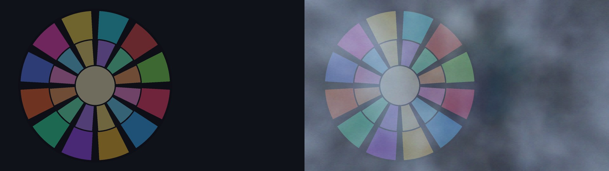

# VolumetricFog3D / 体積霧（3D） / 体积雾（3D）

`VolumetricFog3D.obj2 v2.06` &nbsp;|&nbsp; `VL3DBridge.aux2 v1.22`（任意） &nbsp;|&nbsp; `AviUtl ExEdit2 v2.1.15+` &nbsp;|&nbsp; `MIT License`

[简体中文](../README.md) | [English](README_en.md)

> 🌫️ **AviUtl ExEdit2 用「真・3D」連続ボリュームフォグ・カスタムオブジェクト** —— GPU でリアルタイム積分する連続 3D 密度場。ドット感のある粒子疑似は一切なし。

## 1. 概要・主な特徴

AviUtl2 の 3D カメラ空間にそのまま**連続的な大気フォグ場**を生成します：

- **連続 GPU 3D 密度場**：HLSL ピクセルシェーダーで 4 オクターブ 3D fBm ノイズ・Beer-Lambert 透過率・高度指数減衰・Henyey-Greenstein 前方散乱を高速計算。霧は本物の連続媒質です。
- **ハードウェア Z バッファによる真 3D 遮蔽**：各スライスを 3D ポリゴンとして描画するため、AviUtl2 本体の深度バッファとそのまま噛み合い、手前の被写体はくっきり・奥の背景ほど深い霧に包まれる遮挡関係が**自動**で得られます。
- **編集視点 360° 球体モード**：プレビューの「編集用視点（緑のカメラアイコン）」を検出し、注視点中心の 3D 球体ボリュームへ自動切替。横や斜めへ自由に回り込んでも「謎の縦縞・断面の角」が出ません。
- **任意の GPU 高速化**：[`VL3DBridge.aux2`](https://github.com/CylnaNangong/VolumetricLight3D) 併用時は編集視点のリアルタイム同期。未導入でも純 LuaJIT で全機能が動作します。

> 📜 **v2.05 変更**：スクリプト識別名を「体積霧（3D）」から **`VolumetricFog3D`** へ変更（UI 表示名は言語パックで従来どおりローカライズ）。既存プロジェクトは本 v2.05 を追加し直すか旧バージョンと併置してください。「体積光（3D）」v3.07+ は新旧両名称を自動認識します。

> ✨ **v2.06 共有光場モード**：「散乱光源」で「VolumetricLight3D と連携」を選ぶと、`VL3DLF v3` から局所光色・光線方向・投影影を読み込みます。手動方向が既定で、新しい光場がない場合は手動散乱へ戻ります。各スライスの 4×4 光場サンプルを双線形補間し、ブロック状の境界を抑えます。同一シーン内に VolumetricLight3D v3.16 以降が必要です。

## 2. 動作環境

| 項目 | 要件 |
|---|---|
| 本体 | AviUtl ExEdit2 `v2.1.15` 以上（ＫＥＮくん公式・別途入手） |
| OS | Windows（Direct3D 11） |
| 任意 | `VL3DBridge.aux2 v1.22`（編集視点同期の高速化）、共有光場散乱には VolumetricLight3D v3.16 以降 |

## 3. 導入方法（`.au2pkg.zip` D&D 対応）

1. **`VolumetricFog3D-v2.06.au2pkg.zip`**（フル版）または **`VolumetricFog3D-v2.06-ScriptOnly.au2pkg.zip`**（スクリプト単体版）をダウンロード；
2. zip を **AviUtl2 ウィンドウにドラッグ**するだけで導入完了（公式 D&D 形式）；
3. 手動導入：`Script/VolumetricFog3D.obj2` と `Language/*.aul2` をそれぞれ `C:\ProgramData\aviutl2\Script\`・`Language\` へ。

## 4. 基本的な使い方

1. 任意のレイヤーに「**VolumetricFog3D**」カスタムオブジェクトを追加（背景と人物の間が推奨）；
2. シーンに「カメラ制御」があれば 3D 視点で自動レンダリング。編集用視点では球体モードへ自動切替；
3. 「濃さ」「霧の色」を調整。「手動方向」は従来の X/Y/Z 指定、「VolumetricLight3D と連携」は局所光色・光線方向・投影影に沿った散乱です。

## 5. パラメータ詳細（クリックで展開）

<b>パラメータ一覧（既定値）</b>

| グループ | パラメータ | 範囲（既定） | 説明 |
|---|---|---|---|
| 霧 | 濃さ | 0–100（60） | 霧の全体濃度 |
| 霧 | 霧の色 | —（#a8bcd8） | 霧の基調色 |
| 霧 | 模様の大きさ | 50–4000（550） | ノイズ空間スケール |
| 霧 | 模様の強さ | 0–100（85） | ノイズコントラスト（0=均一） |
| 流れ | 風X/Y/Z | ±2000（15/0/0） | 流速 |
| 流れ | 揺らぎ速さ | 0–10（2） | 乱流速度 |
| 領域 | 手前の距離 / 奥行き | 0–20000（150）/ 100–30000（3200） | 領域の近端・厚み |
| 領域 | 画面の広がり | 100–250（135） | 横方向カバー |
| 領域 | 高さ減衰 / 基準の高さY | 0–100（0）/ ±10000（200） | 高度減衰 |
| 散乱光 | 散乱の強さ | 0–100（25） | 逆光散乱強度 |
| 散乱光 | 光の色 / 前方散乱(g) / 光の向き | —（#dce6ff / 0.45） | HG 位相と方向 |
| 描画 | スライス数 | 8–64（48） | 体積スライス数 |
| 描画 | テクスチャ品質 / 視点追従 / 奥行き減衰 / シード | — | 品質・視点モード・減衰・種 |

## 6. 互換性・内部依存について

- 編集視点検出は `VL3DBridge.aux2` によるホスト内部構造の**読み取り専用**アクセスに依存します。ＫＥＮくん氏の将来更新で内部レイアウトが変わった場合は当該機能のみ失效します（霧自体は標準カメラモードで正常描画され続けます）。
- プラグイン未導入でも全機能が利用可能です。

## 7. 今後の展望（ロードマップ）

- 姉妹作 [`VolumetricLight3D`](https://github.com/CylnaNangong/VolumetricLight3D)（体積光）・[`Snow3D`](https://github.com/CylnaNangong/Snow3D)（雪）との `VL3DBridge` 経由の 3D 光学連動：**体積光で霧を局所的に照らし出す**統合大气システムへ。
- カラーボリュームフォグ（霧内分散）・ボリューム自己遮蔽など。

## 8. バグ報告・フィードバック

- **[GitHub Issues](../../issues) が一番確実！**：スクリプト版数（「ログに出力」ON で `VolumetricFog3D v2.06 ...` 表示）・AviUtl ExEdit2 版数・再現手順・スクリーンショットを添えてください。
- **Discord**：日本語 AviUtl2 情報共有サーバー **「AviUtl2の情報が知りたいだろって‼」**（[参加](https://discord.gg/8qzmGY5NgQ)）で **南宫若馨Cylna**（`@nangongerregtcylna`／作者本人）まで！

## 9. 作者・謝辞・ライセンス

- **作者**：[南宫若馨Cylna](https://github.com/CylnaNangong) ＆ **Arena.ai Agent**
- **謝辞**：ＫＥＮくん氏（AviUtl ExEdit2 本体・Plugin SDK）、AviUtl2 コミュニティ（[nctype](https://github.com/nctype) 氏・[HexBrowns](https://github.com/HexBrowns) 氏・[IZUisMe](https://github.com/IZUisMe) 氏ほか）、**Gemini**（本作の初期 HLSL 霧シェーダーを執筆）、ChatGPT / Microsoft Copilot。
- **ライセンス**：MIT License（[LICENSE](../LICENSE)・[THIRD_PARTY_NOTICES.md](../THIRD_PARTY_NOTICES.md) 参照）。AviUtl ExEdit2 は ＫＥＮくん氏のソフトウェアであり、本プロジェクトとは相互独立です。
